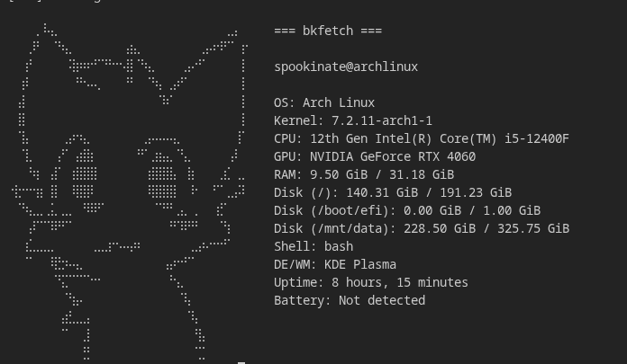

# BKfetch / BoykisserFetch

⠀⠀⠀⠀⠀⣤⣄⡀⠀⠀⠀⠀⠀⠀⠀⠀⠀⣄⠀⠀⠀⠀⠀⠀⠀⠀⠀⠀⠀⠀⠀⠀⠀⠀⠀⠀⠀⠀⠀⠀⠀⠀⠀⠀⠀⠀⠀⠀⠀⠀⠀⠀
⠀⠀⠀⠀⣸⣿⣿⣿⣶⣄⠀⠀⠀⠀⠀⠀⠀⢻⣷⣦⣄⡀⠀⠀⠀⠀⠀⠀⠀⠀⠀⠀⠀⠀⠀⣀⣤⣠⠄⠀⠀⠀⠀⠀⠀⠀⠀⠀⠀⠀⠀⠀
⠀⠀⠀⢀⣿⣿⣿⣿⣿⣿⣿⡀⠴⣾⣿⣿⣿⣤⣿⣿⣿⣿⣷⣦⣄⠀⠀⠀⠀⠀⠀⣀⣤⣾⣿⣿⣿⣿⠀⠀⠀⠀⠀⠀⠀⠀⠀⠀⠀⠀⠀⠀
⠀⠀⠀⣼⣿⣿⣿⣿⣿⣿⣿⣿⣷⣤⡙⠿⣿⣿⣿⣿⣿⣿⣿⣿⣿⣧⣀⠀⠀⣤⣾⣿⣿⣿⣿⣿⣿⣿⠀⠀⠀⠀⠀⠀⠀⠀⠀⠀⠀⠀⠀⠀
⠀⠀⠀⣿⣿⣿⣿⣿⣿⣿⣿⣿⣿⣿⣿⣷⣦⣼⣿⣿⣿⣿⣿⣿⣿⣿⣿⣾⣾⣿⣿⣿⣿⣿⣿⣿⣿⡇⠀⠀⠀⠀⠀⠀⠀⠀⠀⠀⠀⠀⠀⠀
⠀⠀⠀⣿⣿⣿⣿⣿⣿⣿⣿⣿⣿⣿⣿⣿⣿⣿⣿⣿⣿⣿⣿⣿⣿⣿⣿⣿⣿⣿⣿⣿⣿⣿⣿⣿⡿⠀⠀⠀⠀⠀⠀⠀⠀⠀⠀⠀⠀⠀⠀⠀
⠀⠀⠀⣿⣿⣿⣿⣿⣿⣿⣿⣿⣿⣿⣿⣿⣿⣿⣿⣿⣿⣿⣿⣿⣿⣿⣿⣿⣿⣿⣿⣿⣿⣿⣿⣿⠇⠀⠀⠀⠀⠀⠀⠀⠀⠀⠀⠀⠀⠀⠀⠀
⠀⠀⠀⢸⣿⣿⣿⣿⣿⣿⣿⣿⣿⣿⣿⣿⣿⣿⣿⣿⣿⣿⣿⣿⣿⣿⣿⣿⣿⣿⢹⣿⢸⣿⣿⡏⠀⠀⠀⠀⠀⠀⠀⠀⠀⠀⠀⠀⠀⠀⠀⠀
⠀⠀⠀⠀⢻⣿⣿⡿⠿⠟⠻⠿⣿⣿⣿⣿⣿⣿⣿⣿⣿⣿⣿⣿⣿⣿⣿⣿⣿⣿⣌⣃⣼⣿⡟⠀⠀⠀⠀⠀⠀⠀⠀⠀⠀⠀⠀⠀⠀⠀⠀⠀
⢀⣠⣤⣴⣿⣿⣍⣠⣶⣶⣶⣦⡈⢻⣿⣿⣿⣿⣿⣿⡿⠟⠋⠉⠋⠉⠛⢿⣿⣿⣿⣿⣿⠅⠀⠀⠀⠀⠀⠀⠀⠀⠀⠀⠀⠀⠀⠀⠀⠀⠀⠀
⠈⠛⠛⠛⣿⣿⣿⣿⣿⣿⣿⣿⣿⠾⠿⣿⣿⣿⣿⣿⣤⣴⣶⣿⣿⣷⣶⣀⢹⣿⣿⣤⣶⣶⡶⠂⠀⠀⠀⠀⠀⠀⠀⠀⠀⠀⠀⠀⠀⠀⠀⠀
⠀⠀⠀⣰⣯⣛⣉⢩⡟⠟⢿⣿⣿⣦⣤⣿⣿⣿⣿⣿⣿⣿⣿⣿⣿⣿⣿⣿⣿⣿⣿⡿⠟⠋⠁⠀⠀⠀⠀⠀⠀⠀⠀⠀⠀⠀⠀⠀⠀⠀⠀⠀
⠀⠀⢰⠿⠿⠟⠳⣤⣶⣿⣿⣿⣿⣿⣿⣿⣿⣿⡿⢿⣿⣿⣿⣍⣀⡤⠀⠝⢉⣹⣿⣷⠀⠀⠀⠀⠀⠀⠀⠀⠀⠀⠀⠀⠀⠀⠀⠀⠀⠀⠀⠀
⠀⠀⠀⠀⠀⠀⠀⠀⠉⠻⠿⣿⣿⣦⣉⣡⣬⣙⣁⣼⣿⣿⣿⣿⣿⣿⣷⠾⠟⠻⢿⡿⣧⠀⠀⠀⠀⠀⠀⠀⠀⠀⠀⠀⠀⠀⠀⠀⠀⠀⠀⠀
⠀⠀⠀⠀⠀⠀⠀⠀⠀⠀⠀⠀⠉⢉⣹⣿⣿⣿⣿⣿⣿⣿⣉⣉⣭⣍⣀⡀⠀⠀⠀⠀⠀⠀⠀⠀⠀⠀⠀⠀⠀⠀⠀⠀⠀⠀⠀⠀⠀⠀⠀⠀
⠀⠀⠀⠀⠀⠀⠀⠀⠀⠀⠻⠿⣷⣾⣿⣿⣿⣿⣿⣿⡿⠟⣓⣈⣅⣙⡿⠀⠀⠀⠀⠀⠀⠀⠀⠀⠀⠀⠀⠀⠀⠀⠀⠀⠀⠀⠀⠀⠀⠀⠀⠀
⠀⠀⠀⠀⠀⠀⠀⠀⠀⠀⢀⣾⣿⣿⣿⣿⣿⡟⢋⣤⣴⣿⣿⣿⣿⣿⣿⣧⡀⠀⠀⠀⠀⠀⠀⠀⠀⠀⠀⠀⠀⠀⠀⠀⠀⠀⠀⠀⠀⠀⠀⠀
⠀⠀⠀⠀⠀⠀⠀⠀⠀⠀⠾⠿⢿⣿⣿⣿⠏⣴⣿⣿⣿⣿⣿⣿⣿⣿⣿⣿⣿⡆⠀⠀⠀⠀⠀⠀⠀⠀⠀⠀⠀⠀⠀⠀⠀⠀⠀⠀⠀⠀⠀⠀
⠀⠀⠀⠀⠀⠀⠀⠀⠀⠀⠀⠀⣾⣿⣿⣿⣦⠹⡇⣾⣿⣧⢹⣿⡿⠛⢻⣿⣿⣿⡄⠀⠀⠀⠀⠀⠀⠀⠀⠀⠀⠀⠀⠀⠀⠀⡆⠀⠀⠀⠀⠀
⠀⠀⠀⠀⠀⠀⠀⠀⠀⠀⠀⠀⠈⣿⣿⣿⣿⣶⣤⣀⣉⣁⠈⠠⣤⣶⣿⣿⣿⣿⣷⠀⠀⠀⠀⠀⠀⠀⠀⠀⠀⠀⠀⠀⠀⠀⣹⣆⠀⠀⠀⠀
⠀⠀⠀⠀⠀⠀⠀⠀⠀⠀⠀⠀⠀⣿⣿⣿⣿⣿⣿⣿⣿⣿⣿⠀⣿⣿⣿⣿⣿⣿⣿⠇⠀⠀⠀⠀⠀⠀⠀⠀⠀⠀⢀⡄⠀⢰⣿⣿⣧⠀⠀⠀
⠀⠀⠀⠀⠀⠀⠀⠀⠀⠀⠀⠀⠀⣿⣿⣿⣿⣿⣧⢹⣿⣿⣿⣆⢻⣿⣿⣿⣿⣿⠟⠀⠀⠀⠀⠀⠀⠀⠀⠀⠀⢠⣾⣧⠀⣾⣿⣿⣿⣧⡀⠀
⠀⠀⠀⠀⠀⠀⠀⠀⠀⠀⠀⠀⠐⣿⣿⣿⣿⣿⣿⡈⢿⣿⣿⣿⣦⣙⠛⠛⢋⡁⠀⢀⠀⠀⠀⠀⠀⠀⠀⠀⣰⣿⣿⣿⣰⣿⣿⣿⣿⣿⣷⠀
⠀⠀⠀⠀⠀⠀⠀⠀⠀⠀⣀⣤⢀⣿⣿⣿⣿⣿⣿⡇⢸⣿⣿⣿⣿⣿⣿⣿⣿⣷⣿⣁⡀⠀⠀⠀⠀⣀⣴⣾⣿⣿⣿⣿⣿⣿⣿⣿⣿⣿⣿⡇
⠀⠀⠀⠀⠀⠀⠀⠀⠀⣴⣿⣿⢰⣿⣿⣿⣿⣿⣿⣿⢰⣿⣿⣿⣿⣿⣿⣿⣿⣿⣿⣏⢡⣠⣤⣶⣿⣿⣿⣿⣿⣿⣿⣿⣿⣿⣿⣿⣿⣿⣿⡇
⠀⠀⠀⠀⠀⠀⠀⠀⢸⣿⣿⣿⡄⢽⣿⣿⣿⣿⣿⣿⢌⣿⣿⣿⣿⣿⣿⣿⣿⣿⣿⣿⠆⢿⣿⣿⣿⣿⣿⣿⣿⣿⣿⣿⣿⣿⣿⣿⣿⣿⣿⠇

## BoykisserFetch is a system information fetch tool, FOR BOYKISSERSS!!!

It displays:

- Hostname
- OS (Distro)
- Kernel version
- CPU
- GPU
- RAM used / maximum
- Disk usage (`/`) and additional mounted disks
- Shell
- DE/WM
- Uptime
- Battery (if detected)

# Gallery



---

# How to build

## Needed tools

- CMake (3.20 or newer)
- C++17-compatible compiler (GCC or Clang)
- Ninja (optional, if using the Ninja generator)
- Git (to clone the repository)

## Building from source

### 1. Clone the repository

```bash
git clone https://github.com/loren-wastaken/bkfetch.git
cd bkfetch
```

### 2. Configure the project

```bash
cmake -S . -B build -G Ninja
```

### 3. Build

```bash
cmake --build build
```
### 4. Run BKFetch
```
./build/bkfetch
```

# System wide binary detection
If you wanna `bkfetch` command detected across the system, use this command

Sudo:

```
sudo cp build/bkfetch /usr/bin/
```

doas:

```
doas cp build/bkfetch /usr/bin/
```

Licensed under [MIT License](LICENSE)